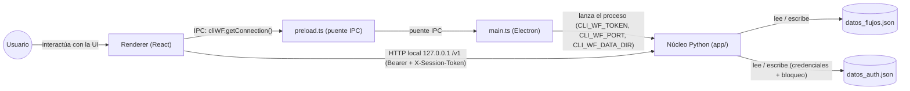
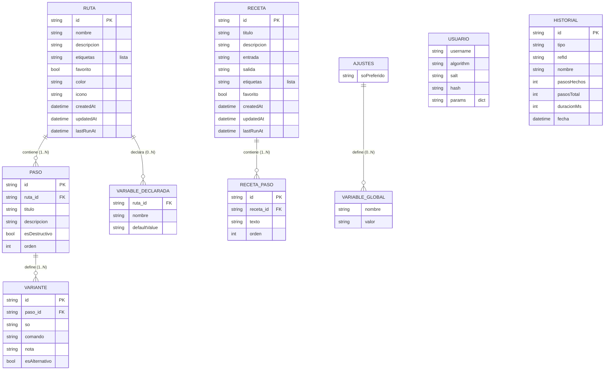
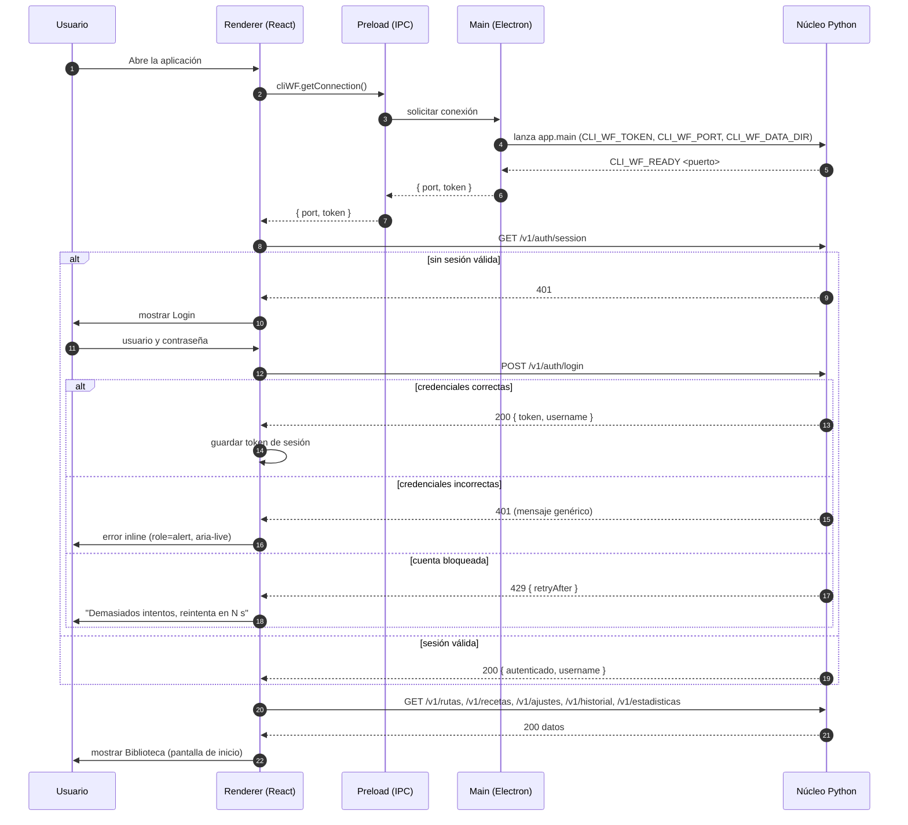
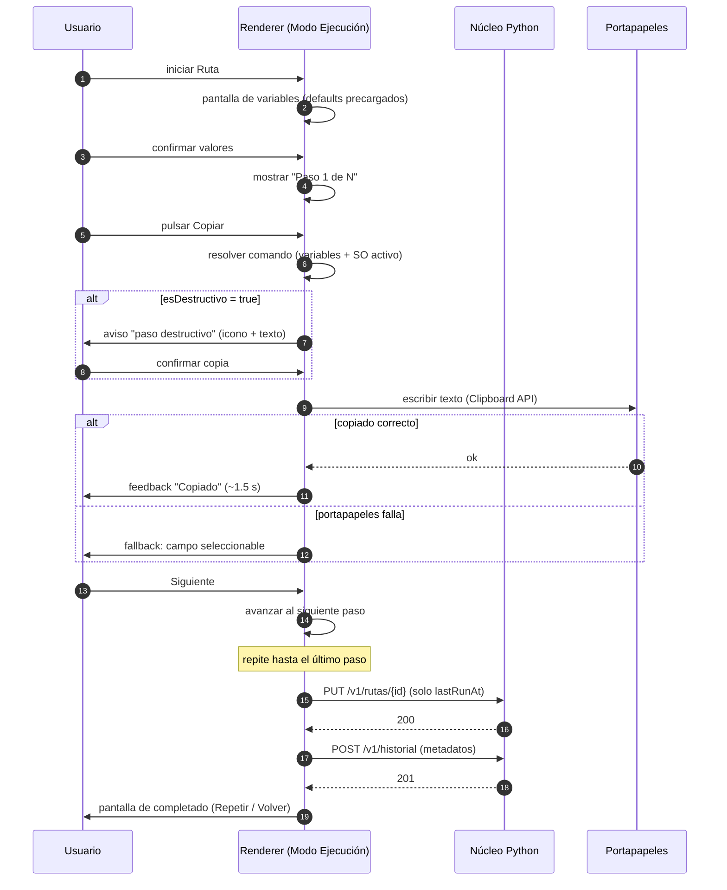
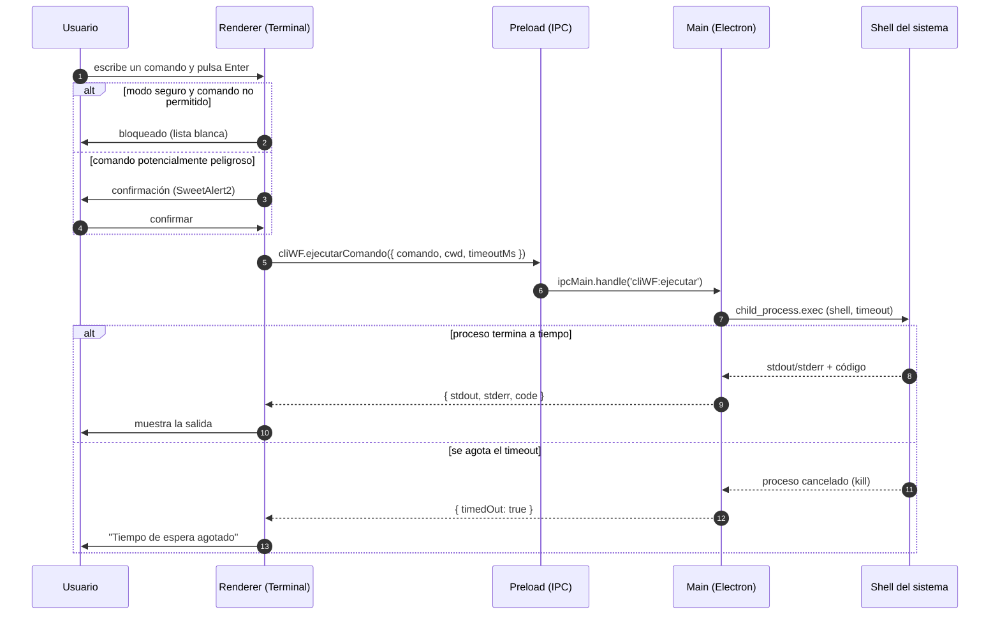
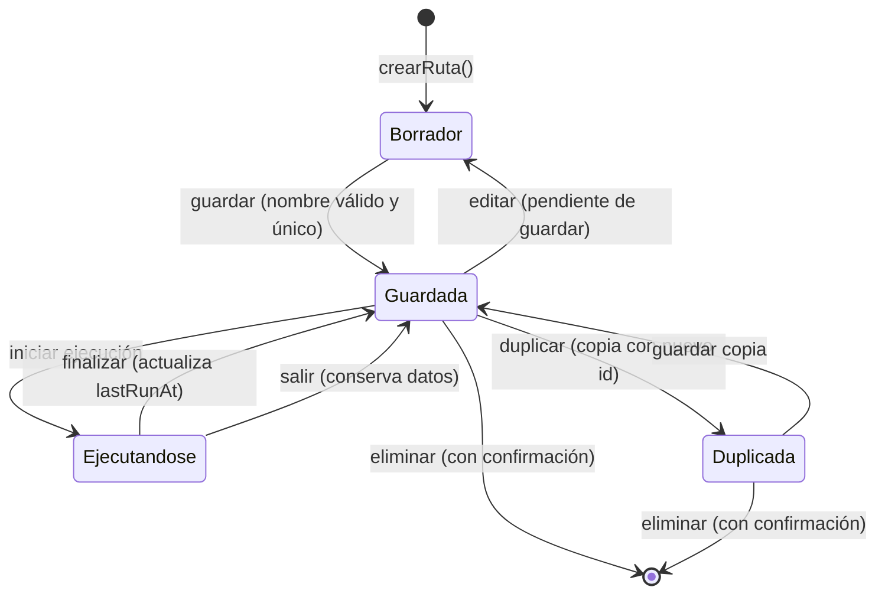

# Especificación de Requisitos de Software (ERS / SRS)

## CLI Workflow Builder — IEEE 830-1998

- Versión del documento: **1.4**
- Fecha: 2026-11-19
- Estándar: IEEE 830-1998
- Estado: Línea base para desarrollo
- SO objetivo: Windows 10/11
- Dependencia de Internet: Ninguna (offline por diseño)

---

# Índice y Matriz de Trazabilidad

## Índice

1. Introducción
   - 1.1 Propósito
   - 1.2 Ámbito (alcance)
   - 1.3 Definiciones, acrónimos y abreviaturas
   - 1.4 Referencias
   - 1.5 Visión general
2. Descripción general
   - 2.1 Perspectiva del producto
   - 2.2 Funciones del producto
   - 2.3 Características de los usuarios
   - 2.4 Restricciones
   - 2.5 Suposiciones y dependencias
   - 2.6 Requisitos futuros
3. Requisitos específicos
   - 3.1 Interfaces externas
   - 3.2 Requisitos funcionales (RF)
   - 3.3 Requisitos de rendimiento
   - 3.4 Restricciones de diseño
   - 3.5 Atributos del sistema (RNF)
4. Diagramas de arquitectura
   - 4.1 Diagrama de contexto
   - 4.2 Diagrama de casos de uso
   - 4.3 Diagrama entidad-relación (DER)
   - 4.4 Diagramas de secuencia
   - 4.5 Diagrama de estados

## Matriz de trazabilidad

Leyenda de prioridades: **M** = Esencial (Must), **S** = Condicional (Should), **C** = Opcional (Could).

### Objetivos de negocio (OB)

| ID | Objetivo de negocio |
|----|---------------------|
| OB-01 | Ofrecer una referencia offline de comandos de consola con variantes por sistema operativo. |
| OB-02 | Permitir recordar, ordenar y practicar flujos secuenciales de comandos (Rutas). |
| OB-03 | Ayudar a descomponer problemas lógicos antes de programar (Recetas). |
| OB-04 | Proteger los datos locales mediante una cuenta única local (sin cuentas en la nube). |
| OB-05 | Garantizar el funcionamiento 100 % offline en Windows 10/11 sin dependencias de Internet. |
| OB-06 | Convertir la práctica en un hábito: historial de ejecuciones, estadísticas y rachas. |
| OB-07 | Permitir ejecutar comandos reales de forma segura (terminal integrada con guardarraíles). |

### Casos de uso (CU)

| ID | Caso de uso |
|----|-------------|
| CU-01 | Consultar un comando en la Biblioteca (buscar, filtrar, copiar). |
| CU-02 | Gestionar Rutas (crear, editar, duplicar, eliminar, reordenar). |
| CU-03 | Ejecutar una Ruta paso a paso (variables, copiado, avisos). |
| CU-04 | Gestionar Recetas y marcar su checklist. |
| CU-05 | Configurar Ajustes (SO preferido, variables globales, import/export). |
| CU-06 | Registrarse e iniciar sesión (cuenta única local). |
| CU-07 | Cerrar sesión y cambiar contraseña. |
| CU-08 | Navegar a la pantalla de inicio (Biblioteca) y filtrar el catálogo. |
| CU-09 | Consultar el progreso (historial, estadísticas, rachas y calendario de actividad). |
| CU-10 | Buscar y ejecutar acciones con la paleta de comandos (Ctrl+K). |
| CU-11 | Ejecutar comandos reales en la terminal integrada (con modo seguro). |
| CU-12 | Exportar a Markdown/cheatsheet y crear desde plantillas. |

### Matriz Objetivo × Caso de uso × Requisito × Criterio

| Objetivo | Caso de uso | Requisitos (RF/RNF) | Criterio / caso de prueba |
|----------|-------------|----------------------|---------------------------|
| OB-01 | CU-01 | RF-063, RF-064, RF-065, RF-066, RF-067, RF-068, RNF-017, RNF-018 | Buscar «subir cambios» devuelve el comando de push; filtros por SO (CMD/PowerShell distinguidos) y categoría; copiado con feedback ~1.5 s; resultado < 300 ms con el catálogo completo. |
| OB-01 | CU-08 | RF-079, RF-081, RF-082, RF-085, RNF-003 | Al iniciar sesión la vista inicial es la Biblioteca; los chips filtran por categoría; la sección Destacados aparece sin filtros activos; el estado vacío ofrece «Limpiar filtros». |
| OB-02 | CU-02 | RF-010, RF-011, RF-012, RF-013, RF-014, RF-015, RF-083, RF-085, RNF-003, RNF-008 | Crear/editar Ruta con nombre único; pasos reordenables; validación (máx. 50 pasos); el Dashboard muestra contadores de Rutas/Recetas/Favoritos/Ejecutados. |
| OB-02 | CU-03 | RF-020, RF-021, RF-022, RF-023, RF-024, RF-025, RF-026, RF-027, RF-028, RF-029, RNF-009, RNF-011 | Pantalla de variables con defaults; barra de progreso; copiado con fallback; aviso de paso destructivo; solo se persiste `lastRunAt`; atajos de teclado. |
| OB-03 | CU-04 | RF-030, RF-031, RF-032, RF-033, RNF-008 | Crear/editar Receta; pasos `{id, texto}`; checklist volátil; toggle «Ocultar pasos» (opcional). |
| OB-05 | CU-05 | RF-040, RF-041, RF-042, RF-084, RNF-001, RNF-006, RNF-007 | SO preferido, variables globales, import/export con confirmación; Ajustes muestra «Acerca de» con versión, stack y atajos. |
| OB-04 | CU-06 | RF-069, RF-070, RF-075, RF-076, RF-077, RNF-010 | `register` 201/409/400; `login` 200/401 genérico; hash `scrypt`/`pbkdf2` con sal 16 bytes; bloqueo 5 fallos → 30 s (429 + `retryAfter`). |
| OB-04 | CU-07 | RF-071, RF-072, RF-073, RF-074, RF-078 | `logout` invalida la sesión; cambio de contraseña invalida todas las sesiones; endpoints de datos sin sesión → 401; borrar `datos_auth.json` restablece el acceso. |
| OB-05 | — (transversal) | RF-050, RF-051, RF-052, RF-060, RF-061, RF-062, RNF-002, RNF-005, RNF-013, RNF-014, RNF-015, RNF-016 | API local solo 127.0.0.1 con token efímero; la UI no accede al JSON; escritura atómica + backup; build reproducible en Windows; arranque en frío < 4 s; API versionada `/v1`. |
| OB-06 | CU-09 | RF-086, RF-087, RF-088, RF-089, RF-090, RNF-019 | Historial con metadatos (sin comandos ni variables, RNF-009); `/v1/historial` y `/v1/estadisticas`; racha actual/máxima; calendario de actividad; vaciado con confirmación. |
| OB-01, OB-02, OB-03 | CU-10 | RF-091, RNF-020 | Paleta de comandos (Ctrl+K) con búsqueda fuzzy por acciones, rutas, recetas y comandos; navegación por teclado y resaltado de coincidencias. |
| OB-07 | CU-11 | RF-092, RF-093, RF-094, RNF-021 | Terminal real vía IPC de Electron (`child_process.exec`) con timeout, modo seguro (lista blanca) y confirmación ante comandos peligrosos. |
| OB-01, OB-02, OB-03 | CU-12 | RF-095, RF-096, RF-097 | Exportar Markdown (cheatsheet completo y por elemento) y plantillas de ejemplo (crear en un clic). |

---

# 1. Introducción

## 1.1 Propósito

Este documento es la **Especificación de Requisitos de Software (ERS/SRS)** del
sistema **CLI Workflow Builder**, redactada conforme al estándar **IEEE 830-1998**.

Define, de forma completa, no ambigua y verificable, los requisitos funcionales y
no funcionales de una aplicación de escritorio **offline para Windows** que ayuda a
un usuario único a:

1. **Recordar y consultar** comandos de consola mediante una Biblioteca con
   variantes por sistema operativo (Windows CMD/PowerShell, macOS y Linux).
2. **Ordenar y practicar** flujos secuenciales de comandos (Rutas) con un Modo de
   Ejecución paso a paso.
3. **Descomponer problemas lógicos** en pasos antes de programar (Recetas).

### Audiencia

| Lector | Interés principal |
|--------|-------------------|
| Equipo de desarrollo | Implementar la UI, el núcleo Python y la persistencia según los requisitos. |
| Ingeniero de requisitos / QA | Verificar trazabilidad, prioridades y criterios de aceptación. |
| Usuario final / product owner | Comprender el alcance y las funcionalidades entregadas. |
| Mantenedores futuros | Mantener la consistencia de la documentación y el diseño. |

## 1.2 Ámbito (Alcance)

### 1.2.1 Nombre del sistema

**CLI Workflow Builder** — Gestor visual de flujos de trabajo para línea de
comandos y descomposición de problemas lógicos.

### 1.2.2 Objetivos

- Proporcionar una referencia offline y fiable de comandos de consola.
- Reducir la fricción de recordar comandos exactos y sus variantes por SO.
- Permitir ejecutar flujos paso a paso copiando comandos al portapapeles.
- Facilitar la descomposición de problemas lógicos antes de programar.
- Proteger los datos locales con una cuenta única local.

### 1.2.3 Beneficios

- Independencia total de Internet y de servicios cloud.
- Aprendizaje y práctica repetible de comandos.
- Reducción de errores al copiar comandos (variantes por SO, aviso de destructivo).
- Privacidad: los datos permanecen en el equipo del usuario.

### 1.2.4 El sistema **hará**

- Mostrar una **Biblioteca** de comandos (catálogo multi-SO) como pantalla de inicio.
- Gestionar **Rutas** (CRUD) con pasos y variantes de comando por SO.
- Ofrecer un **Modo Ejecución** paso a paso con variables y copia al portapapeles.
- Gestionar **Recetas** de lógica con checklist volátil.
- Ofrecer **Ajustes** (SO preferido, variables globales, import/export, cuenta local).
- Persistir todo en un único JSON local con escritura atómica y backup.
- Autenticar una **cuenta única local** (registro, login, cierre de sesión, cambio de contraseña).
- Exponer una **API HTTP local** (`/v1`) consumible únicamente por la propia interfaz.
- Registrar el **historial de ejecuciones** y mostrar **estadísticas y rachas**.
- Ofrecer una **paleta de comandos** global (Ctrl+K) con búsqueda fuzzy.
- Permitir **reordenar pasos con drag & drop** y plegar cada paso.
- **Exportar a Markdown** (cheatsheet) y crear contenido desde **plantillas**.
- Ejecutar **comandos reales** en un terminal integrado con **guardarraíles**.

### 1.2.5 El sistema **no hará** (fuera de alcance)

- Ejecutar automáticamente los comandos de una Ruta (la ejecución real se limita a
  la vista Terminal; las Rutas siguen copiando al portapapeles).
- Sincronizar con la nube ni usar servicios remotos (telemetría, analytics, OAuth).
- Soporte multiusuario o multiprofile compartido.
- Práctica guiada formal (quiz, repetición espaciada).
- Enlace bidireccional Ruta ↔ Receta.
- Internacionalización (interfaz únicamente en español).
- Cifrado en reposo de `datos_flujos.json` (el login es control de acceso, no cifrado).
- Ejecución en sistemas operativos distintos de Windows 10/11.

## 1.3 Definiciones, acrónimos y abreviaturas

| Término | Definición |
|---------|------------|
| **Ruta** | Flujo secuencial ordenado de comandos (pasos) que resuelve una tarea. |
| **Paso** | Unidad de una Ruta: título, descripción, flag destructivo y variantes. |
| **Variante** | Comando concreto asociado a un SO (`windows`, `linux`, `macos`, `any`) con marca de alternativo. |
| **Receta** | Descomposición lógica de un problema (entrada, salida, pasos en texto). |
| **Variable de paso** | Placeholder `{{x}}` detectado en los comandos y rellenado al iniciar la ejecución. |
| **Variable global** | Valor reutilizable definido en Ajustes y resuelto en silencio. |
| **Núcleo** | Proceso Python que expone la API local y gestiona dominio y persistencia. |
| **ERS / SRS** | Especificación de Requisitos de Software (*Software Requirements Specification*). |
| **RF** | Requisito funcional. |
| **RNF** | Requisito no funcional. |
| **M / S / C** | Prioridades: *Must* (esencial), *Should* (condicional), *Could* (opcional). |
| **SO** | Sistema operativo. |
| **SLA** | *Service Level Agreement* (acuerdo de nivel de servicio). |
| **NFKC** | Forma de normalización Unicode de compatibilidad (usada en credenciales). |
| **scrypt / pbkdf2_hmac** | Funciones de derivación de contraseña basadas en clave (KDF). |

## 1.4 Referencias

- **IEEE Std 830-1998** — *IEEE Recommended Practice for Software Requirements Specifications*.
- **README.md** — guía de instalación, uso y estructura del repositorio.
- **docs/architecture.md** — decisiones de arquitectura (Electron + Python + API local).
- **docs/api-contract.md** — contratos de la API local `/v1`.
- **docs/frontend.md** — decisiones de UI/UX (temas, Font Awesome local, SweetAlert2, semántica).
- **docs/changelog.md** — registro de cambios (Keep a Changelog).
- **docs/SRS.md** — resumen de una página de esta especificación (versión de línea base).

## 1.5 Visión general

La ERS se estructura en cuatro bloques:

1. **Índice y trazabilidad**: índice navegable y matriz Objetivo × Caso de uso ×
   Requisito × Criterio de prueba.
2. **Descripción general**: perspectiva del producto, funciones, usuarios,
   restricciones, supuestos y requisitos futuros.
3. **Requisitos específicos**: interfaces externas, requisitos funcionales (fichas
   RF), requisitos de rendimiento, restricciones de diseño y atributos del sistema
   (RNF).
4. **Diagramas de arquitectura**: contexto, casos de uso, entidad-relación,
   secuencia y estados, todos en Mermaid.

---

# 2. Descripción general

## 2.1 Perspectiva del producto

**CLI Workflow Builder** es una aplicación de escritorio autocontenida para
Windows 10/11, compuesta por dos procesos que colaboran en la misma máquina:

1. **Interfaz (Electron + React + TypeScript + Vite).** Renderiza la UI, gestiona
   el tema, la sesión y la interacción del usuario. **Nunca** accede directamente
   al archivo JSON: toda la lectura y escritura de datos pasa por la API local.
2. **Núcleo (Python, biblioteca estándar).** Expone una API HTTP local en
   `127.0.0.1` (puerto efímero, token efímero por variable de entorno) y gestiona
   el dominio (Rutas, Recetas, Ajustes) y la persistencia.

El sistema opera **100 % offline**: no consume CDNs, no envía telemetría y no
depende de servicios cloud. La persistencia es un único archivo
`datos_flujos.json` con `schemaVersion`, escritura atómica (tmp + rename) y backup
automático; las credenciales viven en un archivo separado `datos_auth.json`.

### Contexto dentro del ecosistema

- El usuario interactúa únicamente con la UI de escritorio.
- La UI consume la API local (`/v1`) del núcleo Python.
- El proceso principal de Electron lanza el núcleo, negocia puerto/token y abre la
  ventana (ver Diagrama de contexto, sección 4.1).
- No hay comunicación con sistemas externos; la exposición a red queda fuera del
  alcance.

## 2.2 Funciones del producto

| # | Función | Descripción resumida |
|---|---------|----------------------|
| 1 | **Biblioteca de comandos** | Catálogo de comandos comunes organizado por SO (Windows CMD/PowerShell, macOS, Linux) con búsqueda por acción, filtros por SO y categoría, chips de categoría y sección de destacados. |
| 2 | **Dashboard** | Listado unificado de Rutas y Recetas con búsqueda, filtros, orden y panel de resumen (contadores). |
| 3 | **Constructor de Rutas** | Crear/editar Rutas con pasos y variantes por SO, validación y variables `{{x}}`. |
| 4 | **Modo Ejecución** | Ejecución paso a paso con variables, copiado al portapapeles y avisos de destructivo. |
| 5 | **Recetas de Lógica** | Descomposición de problemas en pasos con checklist volátil. |
| 6 | **Ajustes** | SO preferido, variables globales, import/export, cuenta local y sección «Acerca de». |
| 7 | **API local** | API HTTP `/v1` documentada para rutas, recetas, ajustes, historial, estadísticas, import/export y salud. |
| 8 | **Autenticación local** | Registro, login, cierre de sesión y cambio de contraseña de una cuenta única (offline). |
| 9 | **Progreso** | Historial de ejecuciones, estadísticas, rachas y calendario de actividad. |
| 10 | **Paleta de comandos** | Búsqueda global fuzzy (Ctrl+K) sobre acciones, rutas, recetas y comandos. |
| 11 | **Terminal integrada** | Ejecución real de comandos con modo seguro y confirmación de peligrosos. |
| 12 | **Exportar y plantillas** | Cheatsheet Markdown (completo o por elemento) y plantillas de ejemplo. |

## 2.3 Características de los usuarios

El sistema está pensado para un **usuario único** (solopreneur: desarrollador,
estudiante o entusiasta de la línea de comandos). No hay roles diferenciados ni
multiusuario.

| Rol | Nivel técnico | Responsabilidades | Permisos |
|-----|---------------|-------------------|----------|
| **Usuario único (propietario)** | Básico-medio: conoce la consola pero no memoriza todos los comandos | Crear la cuenta local, mantener Rutas/Recetas/Ajustes, ejecutar flujos, importar/exportar | Acceso total tras autenticarse con la contraseña local |
| **Operador de la máquina (no autenticado)** | — | — | Ninguno: sin sesión solo ve Login/Registro |

La **autenticación local** (una sola cuenta por equipo) protege la interfaz frente
al acceso no autenticado. No es cifrado: `datos_flujos.json` permanece en texto
claro en disco (ver modelo de amenaza en `docs/architecture.md`).

## 2.4 Restricciones

- **Plataforma:** compila y ejecuta únicamente en Windows 10/11 (verificado en MVP).
- **Offline:** sin dependencia de Internet, telemetría, CDNs ni servicios cloud.
- **Persistencia:** un solo archivo JSON local (`datos_flujos.json`) + `datos_auth.json`.
- **Stack fijo:** Electron + React + TypeScript + Vite (UI) y Python biblioteca
  estándar (núcleo); no cambiar sin consultar.
- **Idioma:** interfaz en español (internacionalización fuera de alcance).
- **Dependencias de UI:** Font Awesome y SweetAlert2 **locales** (sin CDN); fuente
  Manrope self-hosted.
- **Seguridad de red:** la API solo escucha en `127.0.0.1` con token efímero.
- **Rendimiento:** arranque en frío < 4 s; operaciones < 300 ms con 200 elementos.

## 2.5 Suposiciones y dependencias

### Suposiciones

- **"Comunicación externa"** se interpreta como la API local offline consumible por
  la propia UI (y, potencialmente, por herramientas locales). La exposición a red
  queda fuera del MVP.
- El **usuario único** es suficiente para el MVP; el modelo de credenciales se
  guarda como lista `users` con un elemento para poder crecer a multiperfil sin
  migrar.
- La **ejecución real** de comandos queda fuera: la app solo copia el comando al
  portapapeles para que el usuario lo pegue en su terminal.

### Dependencias externas

- Toolchain de Electron/Node (npm) para el desarrollo y el build.
- Python embebido (`vendor/python`) para el empaquetado sin Python instalado.
- `electron-builder` para generar el instalador NSIS de Windows.

### No-dependencias

- Internet, servicios cloud, autenticación remota, telemetría.

## 2.6 Requisitos futuros

Evoluciones previstas **fuera del alcance actual**:

- Práctica guiada formal (repetición espaciada, quiz).
- Ejecución automática de los pasos de una Ruta (hoy solo la Terminal ejecuta).
- Enlace bidireccional Ruta ↔ Receta.
- Internacionalización (i18n).
- Multiusuario / multiprofile y sincronización.
- Instaladores firmados y auto-actualización.
- Cifrado en reposo de `datos_flujos.json` (confidencialidad real de los datos).
- Persistencia del estado entre comandos del terminal (historial de `cd`, sesión).

---

# 3. Requisitos específicos

> Prioridades: **M** = Esencial (Must) · **S** = Condicional (Should) · **C** = Opcional (Could).

## 3.1 Interfaces externas

### 3.1.1 Interfaces de usuario (UI/UX)

- **Pantallas:** Login/Registro, Biblioteca (inicio), Dashboard, Constructor de
  Rutas, Modo Ejecución, Recetas (editor y detalle), Progreso, Terminal y Ajustes.
- **Semántica:** toda pantalla usa `<header>`, `<main>`, `<footer>`, `<aside>`
  (sidebar), `<nav>`, `<section>` y `aria-label` donde aplique. No se usa `<div>`
  para todo.
- **Vista inicial:** al autenticarse, la primera pantalla es la **Biblioteca**
  (RF-079), con cabecera de bienvenida, estadísticas del catálogo, chips de
  categoría y sección de destacados.
- **Feedback modal:** SweetAlert2 para confirmación de eliminación, aviso de paso
  destructivo antes de copiar y feedback de copiado. Prohibido `alert()`.
- **Temas:** 10 temas independientes (6 base × claro/oscuro + 4 de daltonismo) con
  CSS variables y atributo `data-theme` en `<html>`, aplicados antes de cargar
  React. Regla de oro de daltonismo: todo estado codificado por color va
  acompañado de icono o texto.
- **Accesibilidad:** navegación por teclado, foco visible (`:focus-visible`),
  `role="alert"`/`aria-live` para errores, `aria-pressed`/`aria-selected` en
  controles conmutables.

### 3.1.2 Interfaces de hardware

- **Requisito mínimo:** equipo con Windows 10/11 capaz de ejecutar Electron.
- **Dispositivos de entrada:** teclado y ratón. No se requieren pantallas táctiles
  ni periféricos especiales.
- **Red:** ninguna (la API local usa la interfaz de loopback `127.0.0.1`, sin
  tarjeta de red externa).
- **Almacenamiento:** espacio en disco para la app empaquetada y los JSON de datos
  (< 5 MB esperados en uso normal).

### 3.1.3 Interfaces de software

- **Sistema operativo:** Windows 10/11.
- **Runtime UI:** Electron 31 + Node (proceso principal), React 18 + TypeScript +
  Vite (renderer).
- **Núcleo:** Python (biblioteca estándar, sin dependencias externas), embebido en
  el paquete para no requerir Python en destino.
- **Persistencia:** archivos JSON locales `datos_flujos.json` (dominio) y
  `datos_auth.json` (credenciales), gestionados con `AtomicJsonStore`.
- **Librerías de UI (locales):** `@fortawesome/fontawesome-free`,
  `sweetalert2`, `@fontsource-variable/manrope` (todas empaquetadas, sin CDN).

### 3.1.4 Interfaces de comunicaciones

- **Protocolo:** HTTP local (solo loopback `127.0.0.1`), puerto efímero elegido en
  el arranque.
- **Formato:** JSON UTF-8 (`Content-Type: application/json`).
- **Autenticación (dos capas):**
  - Transporte: cabecera `Authorization: Bearer <token efímero>`.
  - Sesión: cabecera `X-Session-Token` (obtenida al hacer login).
- **Endpoints:** `/v1/salud`, `/v1/rutas`, `/v1/recetas`, `/v1/ajustes`,
  `/v1/historial`, `/v1/estadisticas`, `/v1/import`, `/v1/export`, `/v1/auth/*`
  (ver `docs/api-contract.md`). La ejecución de comandos no usa esta API: se
  canaliza por IPC de Electron (`cliWF:ejecutar`).
- **Sin comunicación externa:** no hay WebSockets, HTTPS a internet ni servicios
  remotos en el alcance.

## 3.2 Requisitos funcionales (RF)

### 3.2.1 Dashboard

#### RF-001 — Pestañas de filtro por tipo
- **Prioridad:** M
- **Descripción:** Mostrar pestañas «Todo / Rutas / Recetas» con indicador de tipo por tarjeta.
- **Entradas:** selección de pestaña (`todo | rutas | recetas`).
- **Procesamiento:** filtra el listado unificado según el tipo elegido; cada tarjeta muestra su tipo (Ruta/Receta).
- **Salidas:** listado filtrado coherente.
- **Criterio de aceptación:** las tres vistas filtran correctamente y cada tarjeta muestra su tipo.

#### RF-002 — Búsqueda por texto
- **Prioridad:** M
- **Descripción:** Buscar por texto en título, descripción y etiquetas.
- **Entradas:** cadena de búsqueda libre.
- **Procesamiento:** normaliza a minúsculas y compara contra `nombre/título`, `descripción` y `etiquetas`.
- **Salidas:** elementos cuyo texto coincide.
- **Criterio de aceptación:** resultados en menos de 300 ms con 200 elementos.

#### RF-003 — Filtro por etiqueta y favorito
- **Prioridad:** M
- **Descripción:** Filtrar por etiqueta y por favorito, combinable con la búsqueda.
- **Entradas:** etiqueta seleccionada y toggle de favorito.
- **Procesamiento:** intersección de filtros.
- **Salidas:** resultados coherentes.
- **Criterio de aceptación:** combinable con búsqueda; resultados coherentes.

#### RF-004 — Ordenar
- **Prioridad:** M
- **Descripción:** Ordenar por recientes (usa `lastRunAt`), nombre y favorito.
- **Entradas:** criterio de orden.
- **Procesamiento:** orden estable; recientes usa `lastRunAt` descendente.
- **Salidas:** listado ordenado.
- **Criterio de aceptación:** orden estable y persistente en sesión.

#### RF-005 — Acciones rápidas por tarjeta
- **Prioridad:** M
- **Descripción:** Iniciar/Ejecutar, Editar, Duplicar y Eliminar (con confirmación).
- **Entradas:** acción elegida sobre una tarjeta.
- **Procesamiento:** eliminar exige confirmación modal; duplicar crea copia con nuevo `id`.
- **Salidas:** navegación al editor/ejecución, copia creada o elemento eliminado.
- **Criterio de aceptación:** eliminar exige confirmación modal; duplicar crea copia con nuevo `id`.

#### RF-006 — Botones primarios de creación
- **Prioridad:** M
- **Descripción:** Botones «Crear Ruta» y «Crear Receta».
- **Entradas:** clic en el botón.
- **Procesamiento:** abre el editor correspondiente en estado vacío válido.
- **Salidas:** editor abierto.
- **Criterio de aceptación:** abren el editor correspondiente en estado vacío válido.

#### RF-007 — Acceso a Ajustes e Import/Export
- **Prioridad:** M
- **Descripción:** Acceso a Ajustes y a Import/Export.
- **Entradas:** clic en el enlace/botón.
- **Procesamiento:** navegación; Import pide confirmación de sobrescritura.
- **Salidas:** navegación funcional.
- **Criterio de aceptación:** navegación funcional; Import pide confirmación de sobrescritura.

#### RF-083 — Panel de resumen del Dashboard
- **Prioridad:** M
- **Descripción:** Mostrar un panel de resumen con contadores de Rutas, Recetas, Favoritos y Ejecutados.
- **Entradas:** colecciones de `rutas` y `recetas`.
- **Procesamiento:** calcula en el cliente los totales (rutas, recetas, favoritos, elementos con `lastRunAt`).
- **Salidas:** tarjeta `.dashboard-stats` con cuatro contadores.
- **Criterio de aceptación:** los contadores reflejan los datos cargados y se actualizan al recargar.

### 3.2.2 Constructor de Rutas

#### RF-010 — Crear y editar Ruta
- **Prioridad:** M
- **Descripción:** Crear/editar Ruta con nombre (obligatorio, único), descripción, etiquetas, favorito, color e icono.
- **Entradas:** campos del formulario.
- **Procesamiento:** valida nombre obligatorio y único.
- **Salidas:** Ruta guardada o error.
- **Criterio de aceptación:** no se guarda sin nombre; duplicado rechazado con mensaje.

#### RF-011 — Gestionar pasos
- **Prioridad:** M
- **Descripción:** Agregar, insertar en medio, duplicar, eliminar (con confirmación) y reordenar con botones subir/bajar.
- **Entradas:** acciones sobre la lista de pasos.
- **Procesamiento:** reordenamiento reflejado en el campo `orden`; eliminación con confirmación.
- **Salidas:** lista de pasos actualizada.
- **Criterio de aceptación:** reordenamiento reflejado en el campo orden; eliminación con confirmación.

#### RF-012 — Estructura de paso
- **Prioridad:** M
- **Descripción:** Cada paso contiene título, descripción, `esDestructivo` y lista de variantes `{so, comando, nota, esAlternativo}`.
- **Entradas:** datos del paso.
- **Procesamiento:** `so ∈ {windows, linux, macos, any}`.
- **Salidas:** paso válido.
- **Criterio de aceptación:** se permite al menos una variante por paso; `so` en el conjunto válido.

#### RF-013 — Validaciones
- **Prioridad:** M
- **Descripción:** No pasos vacíos, máximo 50 pasos por Ruta, advertencia (no bloqueo) si falta variante para el SO preferido.
- **Entradas:** estado del formulario.
- **Procesamiento:** validación por campo.
- **Salidas:** mensajes junto al campo en lenguaje humano.
- **Criterio de aceptación:** mensajes junto al campo, en lenguaje humano.

#### RF-014 — Declarar variables de paso
- **Prioridad:** M
- **Descripción:** Declarar variables `{{x}}` con `defaultValue` opcional.
- **Entradas:** nombre y default de variable.
- **Procesamiento:** las variables se detectan de los comandos; sus defaults se declaran a nivel de Ruta.
- **Salidas:** variables disponibles.
- **Criterio de aceptación:** la vista previa del comando resuelto refleja el default.

#### RF-015 — Vista previa del comando
- **Prioridad:** S
- **Descripción:** Vista previa del comando con variables resaltadas.
- **Entradas:** comando y variables.
- **Procesamiento:** resalta los tokens `{{x}}`.
- **Salidas:** vista previa estilizada.
- **Criterio de aceptación:** las variables se distinguen visualmente.

### 3.2.3 Modo Ejecución

#### RF-020 — Pantalla previa de variables
- **Prioridad:** M
- **Descripción:** Muestra solo las variables de paso usadas, con defaults precargados y editables.
- **Entradas:** valores de variables.
- **Procesamiento:** no inicia sin rellenar obligatorias; las globales no se piden.
- **Salidas:** valores confirmados.
- **Criterio de aceptación:** no inicia sin rellenar obligatorias; las globales no se piden.

#### RF-021 — Presentación del paso
- **Prioridad:** M
- **Descripción:** Comando resuelto en monoespaciado con variables resaltadas, título, «Paso X de Y», nota y etiqueta de SO activa.
- **Entradas:** paso actual y SO.
- **Procesamiento:** cambia el SO en caliente si hay variantes.
- **Salidas:** paso renderizado.
- **Criterio de aceptación:** cambio de SO en caliente si hay variantes.

#### RF-022 — Progreso y lista lateral
- **Prioridad:** M
- **Descripción:** Barra de progreso siempre visible; lista lateral solo lectura y colapsable.
- **Entradas:** índice de paso.
- **Procesamiento:** no permite saltar pasos.
- **Salidas:** progreso y lista.
- **Criterio de aceptación:** no permite saltar pasos.

#### RF-023 — Botón «Siguiente»
- **Prioridad:** M
- **Descripción:** Botón «Siguiente» siempre habilitado; énfasis visual condicionado a copiar.
- **Entradas:** clic en Siguiente.
- **Procesamiento:** sin diálogos intrusivos; nunca bloquea el avance.
- **Salidas:** avance de paso.
- **Criterio de aceptación:** sin diálogos intrusivos; nunca bloquea el avance.

#### RF-024 — Controles de navegación
- **Prioridad:** M
- **Descripción:** Anterior (conserva variables), Reiniciar (conserva variables, con confirmación) y Salir (confirmación si hay progreso).
- **Entradas:** control elegido.
- **Procesamiento:** comportamiento verificado por control.
- **Salidas:** transición correspondiente.
- **Criterio de aceptación:** comportamiento verificable en cada control.

#### RF-025 — Copiar comando
- **Prioridad:** M
- **Descripción:** Copiar con feedback en el botón (~1.5 s + check); fallback a campo seleccionable si falla el portapapeles.
- **Entradas:** texto a copiar.
- **Procesamiento:** usa la Clipboard API; ante fallo muestra campo seleccionable.
- **Salidas:** comando en portapapeles.
- **Criterio de aceptación:** fallback probado forzando error de portapapeles.

#### RF-026 — Comandos multilínea
- **Prioridad:** M
- **Descripción:** Se copia el bloque completo.
- **Entradas:** comando multilínea.
- **Procesamiento:** copia el bloque íntegro.
- **Salidas:** bloque completo copiado.
- **Criterio de aceptación:** verificado con comando de tres líneas.

#### RF-027 — Aviso de paso destructivo
- **Prioridad:** M
- **Descripción:** Aviso visible si `esDestructivo` es verdadero antes de copiar.
- **Entradas:** flag `esDestructivo`.
- **Procesamiento:** muestra aviso solo cuando aplica.
- **Salidas:** aviso con icono + texto.
- **Criterio de aceptación:** el aviso aparece solo cuando aplica.

#### RF-028 — Pantalla de completado
- **Prioridad:** M
- **Descripción:** Resumen en memoria (pasos y comandos resueltos, no persistido) con acciones Repetir y Volver.
- **Entradas:** fin de la secuencia.
- **Procesamiento:** no escribe nada en disco salvo `lastRunAt`.
- **Salidas:** resumen + acciones.
- **Criterio de aceptación:** no se escribe nada en disco salvo `lastRunAt`.

#### RF-029 — Persistir `lastRunAt`
- **Prioridad:** M
- **Descripción:** Persistir únicamente `lastRunAt` por Ruta al completar.
- **Entradas:** fin de ejecución.
- **Procesamiento:** actualiza `lastRunAt`.
- **Salidas:** JSON con `lastRunAt` actualizado.
- **Criterio de aceptación:** JSON verificado; no contiene valores de variables.

### 3.2.4 Recetas de Lógica

#### RF-030 — Crear y editar Receta
- **Prioridad:** M
- **Descripción:** Título, descripción, entrada y salida (opcionales), etiquetas y favorito.
- **Entradas:** campos del formulario.
- **Procesamiento:** guardado válido sin entrada ni salida.
- **Salidas:** Receta guardada.
- **Criterio de aceptación:** guardado válido sin entrada ni salida.

#### RF-031 — Pasos de la Receta
- **Prioridad:** M
- **Descripción:** Pasos `{id, texto}` ordenados; insertar, duplicar, eliminar (con confirmación) y reordenar.
- **Entradas:** acciones sobre la lista.
- **Procesamiento:** mismo componente reutilizado que en Rutas.
- **Salidas:** lista de pasos actualizada.
- **Criterio de aceptación:** mismo componente reutilizado que en Rutas.

#### RF-032 — Checklist volátil
- **Prioridad:** M
- **Descripción:** Checklist volátil (no persistente) para marcar pasos durante la sesión de pantalla.
- **Entradas:** marcas de check.
- **Procesamiento:** los checks se pierden al cerrar; `lastRunAt` se actualiza al marcar todos o pulsar «Terminé».
- **Salidas:** estado temporal.
- **Criterio de aceptación:** al cerrar la pantalla los checks se pierden; `lastRunAt` se actualiza correctamente.

#### RF-033 — Toggle «Ocultar pasos»
- **Prioridad:** C
- **Descripción:** Desenfoque de los pasos hasta clic por paso.
- **Entradas:** toggle.
- **Procesamiento:** opcional.
- **Salidas:** pasos ocultos/visibles.
- **Criterio de aceptación:** funcional si se implementa; no bloquea entrega.

### 3.2.5 Ajustes

#### RF-040 — Variables globales
- **Prioridad:** M
- **Descripción:** Definir variables globales `{{x}}` reutilizables.
- **Entradas:** pares nombre/valor.
- **Procesamiento:** precedencia paso sobre global.
- **Salidas:** variables disponibles en todas las Rutas.
- **Criterio de aceptación:** disponibles en todas las Rutas; precedencia paso sobre global.

#### RF-041 — Sistema operativo preferido
- **Prioridad:** M
- **Descripción:** Configurar el SO preferido.
- **Entradas:** selección de SO.
- **Procesamiento:** afecta la variante mostrada por defecto y las advertencias del Constructor.
- **Salidas:** preferencia guardada.
- **Criterio de aceptación:** afecta la variante mostrada por defecto y las advertencias del Constructor.

#### RF-042 — Import y Export
- **Prioridad:** M
- **Descripción:** Importar y exportar el JSON propio.
- **Entradas:** archivo JSON o acción de export.
- **Procesamiento:** Import valida estructura mínima y pide confirmación de sobrescritura.
- **Salidas:** JSON exportado o almacén reemplazado.
- **Criterio de aceptación:** Import valida estructura mínima y pide confirmación de sobrescritura.

#### RF-084 — Sección «Acerca de»
- **Prioridad:** M
- **Descripción:** Sección informativa en Ajustes con versión, stack, atajos y consejo de uso.
- **Entradas:** constante `APP_VERSION` y datos estáticos.
- **Procesamiento:** renderiza el bloque informativo sin llamadas extra.
- **Salidas:** tarjeta «Acerca de» con versión, stack y atajos.
- **Criterio de aceptación:** la versión mostrada coincide con `package.json` y los atajos listados son correctos.

### 3.2.6 API local del núcleo

#### RF-050 — Endpoints de la API
- **Prioridad:** M
- **Descripción:** Exponer `/v1/rutas`, `/v1/recetas`, `/v1/ajustes`, `/v1/import`, `/v1/export` y `/v1/salud`.
- **Entradas:** peticiones HTTP.
- **Procesamiento:** la interfaz opera exclusivamente vía API.
- **Salidas:** respuestas JSON documentadas.
- **Criterio de aceptación:** contratos documentados; la interfaz opera exclusivamente vía API.

#### RF-051 — Escucha segura
- **Prioridad:** M
- **Descripción:** Escuchar solo en `127.0.0.1`, puerto libre automático y token efímero por variable de entorno.
- **Entradas:** arranque del núcleo.
- **Procesamiento:** rechaza accesos remotos y peticiones sin token.
- **Salidas:** 401 sin token; 403 origen no local.
- **Criterio de aceptación:** petición sin token devuelve 401; acceso remoto rechazado.

#### RF-052 — Sin acceso directo al JSON
- **Prioridad:** M
- **Descripción:** La interfaz no accede directamente al JSON.
- **Entradas:** revisión de código.
- **Procesamiento:** toda lectura/escritura pasa por la API.
- **Salidas:** frontend sin I/O de archivos.
- **Criterio de aceptación:** revisión de código sin lecturas ni escrituras de archivo en el frontend.

### 3.2.7 Persistencia

#### RF-060 — JSON único con `schemaVersion`
- **Prioridad:** M
- **Descripción:** Persistir todo en `datos_flujos.json` con `schemaVersion`.
- **Entradas:** estado del dominio.
- **Procesamiento:** archivo legible; versión numérica presente.
- **Salidas:** JSON persistido.
- **Criterio de aceptación:** archivo legible; versión numérica presente.

#### RF-061 — Escritura atómica y backup
- **Prioridad:** M
- **Descripción:** Escritura atómica (tmp + rename) y backup antes de cada guardado exitoso.
- **Entradas:** guardado.
- **Procesamiento:** escribe `.tmp` y `os.replace`; copia el estado anterior a `.bak`.
- **Salidas:** archivo consistente.
- **Criterio de aceptación:** simulación de cierre a mitad de guardado no corrompe el original.

#### RF-062 — Corrupción
- **Prioridad:** M
- **Descripción:** Si el JSON está corrupto, no sobrescribir; avisar y ofrecer restaurar backup.
- **Entradas:** archivo corrupto.
- **Procesamiento:** intenta restaurar desde `.bak`; conserva el corrupto como `.corrupt`.
- **Salidas:** datos restaurados o error claro.
- **Criterio de aceptación:** escenario probado con archivo corrupto.

### 3.2.8 Biblioteca de comandos

#### RF-063 — Catálogo de comandos
- **Prioridad:** M
- **Descripción:** Comandos comunes organizados por SO (Windows CMD/PowerShell, macOS, Linux).
- **Entradas:** catálogo estático local.
- **Procesamiento:** incluye al menos Git, navegación, gestión de archivos, permisos y usuarios, red, procesos, instalación de paquetes, búsqueda, variables de entorno y redirecciones/pipes.
- **Salidas:** catálogo navegable.
- **Criterio de aceptación:** incluye como mínimo las 10 categorías indicadas.

#### RF-064 — `sameInAllOS`
- **Prioridad:** M
- **Descripción:** Comandos idénticos en todos los SO se marcan `sameInAllOS: true` sin duplicar.
- **Entradas:** definición del comando.
- **Procesamiento:** cada comando idéntico se define una sola vez.
- **Salidas:** catálogo sin duplicados.
- **Criterio de aceptación:** cada comando idéntico se define una sola vez.

#### RF-065 — Búsqueda por acción
- **Prioridad:** M
- **Descripción:** El buscador filtra por acción, descripción, comando y etiquetas.
- **Entradas:** cadena de búsqueda.
- **Procesamiento:** comparación sobre el texto agregado del comando.
- **Salidas:** resultados.
- **Criterio de aceptación:** «subir cambios» devuelve push; < 300 ms con el catálogo completo.

#### RF-066 — Filtro por SO
- **Prioridad:** M
- **Descripción:** Filtro Todos / Windows / macOS / Linux; en Windows se distinguen CMD y PowerShell.
- **Entradas:** selección de SO.
- **Procesamiento:** filtra por aplicabilidad del comando al SO.
- **Salidas:** comandos aplicables.
- **Criterio de aceptación:** al filtrar por SO solo se muestran los comandos aplicables; CMD/PowerShell distinguidos.

#### RF-067 — Filtro por categoría
- **Prioridad:** S
- **Descripción:** Filtrar por categoría, combinable con búsqueda y SO.
- **Entradas:** selección de categoría.
- **Procesamiento:** intersección de filtros.
- **Salidas:** resultados.
- **Criterio de aceptación:** combinable con búsqueda y filtro de SO.

#### RF-068 — Copiar comando
- **Prioridad:** M
- **Descripción:** Copiar al portapapeles con feedback en el botón.
- **Entradas:** texto del comando.
- **Procesamiento:** feedback ~1.5 s; fallback si falla el portapapeles.
- **Salidas:** comando copiado.
- **Criterio de aceptación:** feedback visual ~1.5 s; fallback si el portapapeles falla.

#### RF-079 — Biblioteca como pantalla de inicio
- **Prioridad:** M
- **Descripción:** La vista inicial tras autenticarse (o al arrancar con sesión válida) es la Biblioteca, no el Dashboard.
- **Entradas:** evento de arranque/login/logout/cambio de contraseña.
- **Procesamiento:** el estado de vista por defecto es `{ nombre: 'biblioteca' }`.
- **Salidas:** Biblioteca visible como primera pantalla.
- **Criterio de aceptación:** al reiniciar la app y tras iniciar sesión, se muestra la Biblioteca.

#### RF-080 — Cabecera de bienvenida y estadísticas
- **Prioridad:** M
- **Descripción:** Cabecera de la Biblioteca con texto de introducción y estadísticas del catálogo (comandos, categorías, sistemas).
- **Entradas:** `COMANDOS` y `CATEGORIAS` del catálogo.
- **Procesamiento:** cálculo en cliente en tiempo constante.
- **Salidas:** bloque `.biblioteca-hero` con tres contadores.
- **Criterio de aceptación:** los contadores coinciden con el catálogo (comandos, categorías, 3 sistemas).

#### RF-081 — Chips de categoría
- **Prioridad:** M
- **Descripción:** Píldoras (chips) para filtrar por categoría con un clic, además del selector.
- **Entradas:** clic en un chip.
- **Procesamiento:** fija la categoría activa; «Todas» limpia el filtro.
- **Salidas:** listado filtrado.
- **Criterio de aceptación:** cada chip filtra correctamente y el chip activo queda resaltado.

#### RF-082 — Sección «Destacados»
- **Prioridad:** M
- **Descripción:** Sección de comandos destacados en tarjetas compactas, visible cuando no hay filtros activos.
- **Entradas:** lista de IDs destacados.
- **Procesamiento:** muestra la variante principal de cada comando destacado.
- **Salidas:** tarjetas destacadas con copiado.
- **Criterio de aceptación:** aparece solo sin filtros activos y cada tarjeta permite copiar.

#### RF-085 — Estados vacíos accionables
- **Prioridad:** M
- **Descripción:** Los estados vacíos ofrecen acciones («Crear Ruta/Receta», «Limpiar filtros»).
- **Entradas:** resultado vacío.
- **Procesamiento:** renderiza botones de acción contextuales.
- **Salidas:** estado vacío con botones.
- **Criterio de aceptación:** el Dashboard sin datos ofrece crear; la Biblioteca sin resultados ofrece limpiar filtros.

### 3.2.9 Autenticación local

#### RF-069 — Registro de cuenta única
- **Prioridad:** M
- **Descripción:** Registrar una única cuenta local (usuario y contraseña).
- **Entradas:** `{ username, password }`.
- **Procesamiento:** `POST /v1/auth/register`.
- **Salidas:** `201`; `409` si ya existe; `400` si no cumple la política.
- **Criterio de aceptación:** `201`/`409`/`400` según corresponda.

#### RF-070 — Login local
- **Prioridad:** M
- **Descripción:** Iniciar sesión y devolver token de sesión y usuario.
- **Entradas:** `{ username, password }`.
- **Procesamiento:** `POST /v1/auth/login`.
- **Salidas:** `200 {token, username}`; `401` genérico; `429` si bloqueado.
- **Criterio de aceptación:** `401` con mensaje genérico «Usuario o contraseña incorrectos».

#### RF-071 — Cierre de sesión
- **Prioridad:** M
- **Descripción:** Invalidar la sesión actual.
- **Entradas:** `POST /v1/auth/logout`.
- **Procesamiento:** invalida el token de sesión.
- **Salidas:** `200 { ok }`.
- **Criterio de aceptación:** tras `logout`, el token de sesión deja de ser válido.

#### RF-072 — Estado de sesión al arrancar
- **Prioridad:** M
- **Descripción:** La UI consulta la sesión y, si no la hay, muestra Login (nunca el contenido).
- **Entradas:** arranque.
- **Procesamiento:** `GET /v1/auth/session`.
- **Salidas:** Login o shell.
- **Criterio de aceptación:** al reiniciar la app se vuelve a pedir login.

#### RF-073 — Cambio de contraseña
- **Prioridad:** M
- **Descripción:** Cambiar la contraseña (requiere sesión).
- **Entradas:** `{ current, new }`.
- **Procesamiento:** exige la actual, valida la nueva e invalida todas las sesiones.
- **Salidas:** `200 { ok }`.
- **Criterio de aceptación:** invalida todas las sesiones.

#### RF-074 — Protección de datos
- **Prioridad:** M
- **Descripción:** Todos los endpoints de datos exigen token de sesión.
- **Entradas:** peticiones a endpoints de datos.
- **Procesamiento:** exige `X-Session-Token`.
- **Salidas:** `401` sin sesión.
- **Criterio de aceptación:** petición sin sesión a rutas/recetas/ajustes/import/export devuelve `401`.

#### RF-075 — Credenciales seguras
- **Prioridad:** M
- **Descripción:** Contraseña derivada con `scrypt` (o `pbkdf2_hmac`), sal de 16 bytes y `hmac.compare_digest`.
- **Entradas:** contraseña.
- **Procesamiento:** hash + sal + parámetros persistidos.
- **Salidas:** `datos_auth.json` sin contraseña en claro.
- **Criterio de aceptación:** `datos_auth.json` nunca contiene la contraseña en claro; dos registros de la misma contraseña producen hashes distintos.

#### RF-076 — Política de contraseña
- **Prioridad:** M
- **Descripción:** 8–128 caracteres, sin espacios al inicio/fin, sin exigir mayúsculas ni símbolos; normalización NFKC y medidor de fuerza.
- **Entradas:** contraseña.
- **Procesamiento:** validación y normalización NFKC.
- **Salidas:** aceptación o rechazo con mensaje claro.
- **Criterio de aceptación:** contraseñas fuera de política se rechazan con mensaje claro.

#### RF-077 — Bloqueo temporal
- **Prioridad:** M
- **Descripción:** 5 intentos fallidos → bloqueo de 30 s con backoff; contador persistido.
- **Entradas:** intentos de login.
- **Procesamiento:** incrementa contador; bloquea y persiste `lockedUntil`.
- **Salidas:** `429` con `retryAfter`.
- **Criterio de aceptación:** el sexto intento responde `429` con `retryAfter`; al expirar, el login vuelve a funcionar.

#### RF-078 — Restablecimiento de acceso
- **Prioridad:** M
- **Descripción:** Borrar `datos_auth.json` restablece el acceso sin tocar los datos de flujos.
- **Entradas:** eliminación del archivo.
- **Procesamiento:** sin recuperación de contraseña.
- **Salidas:** acceso restablecido.
- **Criterio de aceptación:** documentado en README y en Ajustes.

### 3.2.10 Progreso e historial

#### RF-086 — Registro automático de ejecuciones
- **Prioridad:** M
- **Descripción:** Registrar una entrada de historial al completar una Ruta o una Receta.
- **Entradas:** evento de completado (Ruta en Modo Ejecución; Receta al marcar todos los pasos o pulsar «Terminé»).
- **Procesamiento:** `POST /v1/historial` con `{tipo, refId, nombre, pasosHechos, pasosTotal, duracionMs}`; el núcleo genera `id` y `fecha`.
- **Salidas:** registro persistido en `datos_flujos.json`.
- **Criterio de aceptación:** cada completado genera exactamente una entrada; los campos reflejan lo ejecutado.

#### RF-087 — Estadísticas agregadas
- **Prioridad:** M
- **Descripción:** Calcular totales (ejecuciones, rutas, recetas, pasos, días activos) desde el historial.
- **Entradas:** historial persistido.
- **Procesamiento:** `GET /v1/estadisticas` agrega en el núcleo (funciones puras en `app/estadisticas.py`).
- **Salidas:** resumen listo para la UI.
- **Criterio de aceptación:** los contadores coinciden con el historial; sin derivados persistidos.

#### RF-088 — Rachas y calendario de actividad
- **Prioridad:** M
- **Descripción:** Mostrar la racha actual, la racha máxima y un calendario de actividad (6 meses).
- **Entradas:** días con actividad.
- **Procesamiento:** cálculo de días consecutivos y `porDia` (371 días) en el núcleo.
- **Salidas:** vista Progreso con rachas y rejilla de actividad.
- **Criterio de aceptación:** la racha sobrevive si aún no hubo actividad hoy; la rejilla colorea por intensidad con `title` textual.

#### RF-089 — Vaciado del historial
- **Prioridad:** M
- **Descripción:** Permitir vaciar todo el historial con confirmación.
- **Entradas:** acción «Vaciar historial».
- **Procesamiento:** `DELETE /v1/historial` (sin id) con confirmación SweetAlert2.
- **Salidas:** historial vacío; rutas y recetas intactas.
- **Criterio de aceptación:** solo se elimina el historial; los datos de flujo no se tocan.

#### RF-090 — Privacidad del historial
- **Prioridad:** M
- **Descripción:** El historial solo guarda metadatos; nunca comandos resueltos ni valores de variables.
- **Entradas:** registro de ejecución.
- **Procesamiento:** no se persisten `comando` ni `variables` (RNF-009).
- **Salidas:** JSON sin tokens ni contraseñas.
- **Criterio de aceptación:** auditoría del JSON tras ejecuciones no encuentra valores de variables.

### 3.2.11 Paleta de comandos

#### RF-091 — Paleta global con búsqueda fuzzy
- **Prioridad:** M
- **Descripción:** Ctrl+K (o Cmd+K) abre una paleta que busca acciones, Rutas, Recetas y comandos del catálogo.
- **Entradas:** consulta de texto.
- **Procesamiento:** búsqueda por subsecuencia (`lib/fuzzy.ts`) con ranking y resaltado; navegación `↑`/`↓`/`Enter`/`Esc`.
- **Salidas:** lista de resultados; ejecutar la acción (navegar o copiar comando).
- **Criterio de aceptación:** funciona en cualquier pantalla; copiar un comando usa la variante del SO preferido; < 300 ms.

### 3.2.12 Terminal integrada

#### RF-092 — Ejecución real de comandos
- **Prioridad:** M
- **Descripción:** Ejecutar comandos reales del sistema en la vista Terminal.
- **Entradas:** comando y directorio de trabajo (por defecto la carpeta de usuario).
- **Procesamiento:** IPC `cliWF:ejecutar` → `child_process.exec` en el proceso principal, con `cwd`, timeout y captura de `stdout`/`stderr`.
- **Salidas:** salida, error y código de salida mostrados.
- **Criterio de aceptación:** un comando como `whoami` devuelve el usuario; los errores se muestran como texto.

#### RF-093 — Modo seguro (lista blanca)
- **Prioridad:** M
- **Descripción:** Modo seguro activado por defecto que solo permite comandos de consulta.
- **Entradas:** toggle de modo seguro.
- **Procesamiento:** `lib/terminal.ts` valida contra una lista blanca; bloquea con mensaje.
- **Salidas:** bloqueo o ejecución.
- **Criterio de aceptación:** un comando no permitido se bloquea con mensaje sin ejecutarse.

#### RF-094 — Confirmación de peligrosos y timeout
- **Prioridad:** M
- **Descripción:** Los comandos potencialmente destructivos piden confirmación; toda ejecución tiene timeout.
- **Entradas:** comando peligroso (heurística) o proceso colgado.
- **Procesamiento:** confirmación SweetAlert2 antes de ejecutar; timeout (30 s por defecto, máx. 120 s) cancela el proceso.
- **Salidas:** ejecución confirmada o cancelada; proceso cancelado al agotar el tiempo.
- **Criterio de aceptación:** el aviso aparece solo ante comandos peligrosos; un comando que no termina se cancela.

### 3.2.13 Exportar y plantillas

#### RF-095 — Exportar a Markdown
- **Prioridad:** M
- **Descripción:** Exportar Rutas, Recetas, Biblioteca o un cheatsheet completo a Markdown.
- **Entradas:** selección del ámbito.
- **Procesamiento:** `lib/markdown.ts` genera el texto con placeholders `{{x}}` sin resolver; descarga `.md` o copia al portapapeles.
- **Salidas:** archivo Markdown o texto copiado.
- **Criterio de aceptación:** el comando exportado conserva los placeholders (RNF-009).

#### RF-096 — Plantillas
- **Prioridad:** M
- **Descripción:** Crear Rutas y Recetas de ejemplo desde plantillas predefinidas.
- **Entradas:** plantilla elegida.
- **Procesamiento:** `lib/plantillas.ts` materializa el elemento con nombre único y lo guarda.
- **Salidas:** elemento creado y editor abierto.
- **Criterio de aceptación:** «Usar» crea el elemento y abre su editor; nombres duplicados reciben sufijo.

#### RF-097 — Reordenar con drag & drop
- **Prioridad:** M
- **Descripción:** Reordenar pasos y variantes arrastrando el asa de cada tarjeta.
- **Entradas:** arrastre del asa.
- **Procesamiento:** `EditableList` gestiona el drag & drop con `onReorder(from, to)`; los botones ↑/↓ siguen disponibles como alternativa accesible.
- **Salidas:** orden actualizado.
- **Criterio de aceptación:** arrastrar y soltar reordena correctamente; el reordenado por teclado (botones) sigue funcionando.

## 3.3 Requisitos de rendimiento

| ID | Métrica | Valor objetivo | Método de verificación |
|----|---------|----------------|------------------------|
| PERF-01 | Arranque en frío | < 4 s | Medición cronometrada con build de producción. |
| PERF-02 | Latencia por operación (200 elementos Rutas+Recetas) | < 300 ms | Prueba con archivo de 200 elementos. |
| PERF-03 | Latencia de API por endpoint (200 elementos) | < 100 ms | Medición sobre `/v1/*` con archivo de prueba. |
| PERF-04 | Búsqueda/filtrado de Biblioteca (catálogo completo) | < 300 ms | Medición con el catálogo completo. |
| PERF-05 | Cálculo de estadísticas y chips (Biblioteca/Dashboard) | Sin latencia perceptible (O(n) en cliente) | Revisión de complejidad + medición. |
| PERF-06 | Almacenamiento en uso normal | < 5 MB | Verificación con archivo de prueba. |
| PERF-07 | Usuarios concurrentes | 1 (usuario único) | Por diseño; sin concurrencia multi-usuario. |

## 3.4 Restricciones de diseño

- **Arquitectura:** dos procesos (Electron + Python) con API HTTP local; el
  renderer no accede al JSON directamente (separación dominio/persistencia/UI).
- **Estándares de código:** TypeScript estricto (`tsc --noEmit`) y Python con
  `unittest`; separación clara de capas y componentes reutilizables
  (`EditableList`, `PasswordInput`, `ThemeSelector`).
- **Compatibilidad:** solo Windows 10/11 en el MVP; API versionada con prefijo
  `/v1` (cambios incompatibles → `/v2`).
- **Offline:** ninguna dependencia de red; librerías de UI empaquetadas localmente.
- **Accesibilidad:** regla de oro de daltonismo (color + icono/texto), navegación
  por teclado y foco visible.
- **Seguridad de la API:** bind a `127.0.0.1`, token efímero por variable de
  entorno y verificación del origen local.

## 3.5 Atributos del sistema (Requisitos No Funcionales)

### RNF-001 — Offline por diseño
- **Categoría:** Fiabilidad / Seguridad.
- **Descripción:** Ninguna funcionalidad depende de Internet ni envía telemetría.
- **Métrica:** 100 % de las funciones operan con la red desconectada.

### RNF-002 — Compilación en Windows
- **Categoría:** Portabilidad.
- **Descripción:** Build reproducible desde cero en máquina limpia.
- **Métrica:** `npm run build`/`dist:win` exitoso en VM limpia con instrucciones README.

### RNF-003 — Usabilidad
- **Categoría:** Usabilidad.
- **Descripción:** Toda operación destructiva pide confirmación; errores junto al campo en lenguaje humano.
- **Métrica:** inspección + checklist de aceptación (0 operaciones destructivas sin confirmación).

### RNF-004 — Primera Ruta en < 3 minutos
- **Categoría:** Usabilidad.
- **Descripción:** Un usuario nuevo crea su primera Ruta en menos de 3 minutos sin manual.
- **Métrica:** prueba con 2–3 personas ajenas; registro de tiempos.

### RNF-005 — Rendimiento de arranque y operaciones
- **Categoría:** Rendimiento.
- **Descripción:** Arranque < 4 s; operaciones < 300 ms con 200 elementos.
- **Métrica:** medición documentada con archivo de prueba.

### RNF-006 — Almacenamiento
- **Categoría:** Rendimiento.
- **Descripción:** Un solo JSON + backup; < 5 MB en uso normal.
- **Métrica:** verificación con archivo de prueba.

### RNF-007 — Fiabilidad de datos
- **Categoría:** Fiabilidad.
- **Descripción:** Escritura atómica, backup y `schemaVersion`.
- **Métrica:** pruebas de corrupción y restauración superadas.

### RNF-008 — Mantenibilidad
- **Categoría:** Mantenibilidad.
- **Descripción:** Componentes reutilizados; separación de dominio, persistencia e interfaz.
- **Métrica:** revisión de código (sin duplicación de lógica de lista/orden).

### RNF-009 — Privacidad
- **Categoría:** Seguridad.
- **Descripción:** No se persisten valores de variables (tokens, rutas, contraseñas).
- **Métrica:** auditoría del JSON tras ejecuciones (sin valores de variables).

### RNF-010 — Seguridad de la API local
- **Categoría:** Seguridad.
- **Descripción:** Solo `127.0.0.1`, token efímero por arranque, rechazo de orígenes no locales.
- **Métrica:** pruebas de acceso sin token y desde otra interfaz → 401/403.

### RNF-011 — Accesibilidad mínima (teclado)
- **Categoría:** Usabilidad.
- **Descripción:** Atajos en Modo Ejecución (→/Enter, ←, C, R, Esc); teclas de una letra inactivas con foco en campo de texto.
- **Métrica:** pruebas manuales de teclado superadas.

### RNF-012 — Contraste
- **Categoría:** Usabilidad.
- **Descripción:** Contraste suficiente en resaltado de variables y avisos de destructivo.
- **Métrica:** verificación visual con herramienta de contraste (WCAG AA).

### RNF-013 — API versionada
- **Categoría:** Mantenibilidad.
- **Descripción:** API documentada y versionada (`/v1`); cambios incompatibles → `/v2`.
- **Métrica:** contrato documentado en el repositorio.

### RNF-014 — Latencia de API
- **Categoría:** Rendimiento.
- **Descripción:** < 100 ms por endpoint con 200 elementos.
- **Métrica:** medición con archivo de prueba.

### RNF-015 — Compatibilidad
- **Categoría:** Portabilidad.
- **Descripción:** Solo Windows 10/11 verificado en MVP.
- **Métrica:** declarado en README y SRS.

### RNF-016 — Internacionalización
- **Categoría:** Portabilidad.
- **Descripción:** Fuera del MVP; interfaz en español.
- **Métrica:** declarado.

### RNF-017 — Rendimiento de la Biblioteca
- **Categoría:** Rendimiento.
- **Descripción:** Búsqueda y filtrado < 300 ms con el catálogo completo.
- **Métrica:** medición documentada.

### RNF-018 — Filtros por SO sin depender solo del color
- **Categoría:** Usabilidad.
- **Descripción:** Cada variante muestra su etiqueta (CMD/PowerShell/macOS/Linux).
- **Métrica:** verificación visual en temas de daltonismo.

### RNF-019 — Privacidad del historial
- **Categoría:** Seguridad.
- **Descripción:** El historial solo guarda metadatos; nunca comandos resueltos ni valores de variables.
- **Métrica:** auditoría del JSON tras ejecuciones (sin tokens ni contraseñas).

### RNF-020 — Rendimiento de la paleta de comandos
- **Categoría:** Rendimiento.
- **Descripción:** Búsqueda fuzzy < 300 ms sobre todo el espacio de búsqueda (catálogo + rutas + recetas + acciones).
- **Métrica:** medición con el catálogo completo.

### RNF-021 — Seguridad del terminal integrado
- **Categoría:** Seguridad.
- **Descripción:** Ejecución con timeout (≤ 120 s), modo seguro por defecto, confirmación ante comandos peligrosos y alcance limitado a la vista Terminal (sin persistencia de salida ni de estado).
- **Métrica:** pruebas de bloqueo en modo seguro y de cancelación por timeout.

---

# 4. Diagramas de arquitectura

Los siguientes diagramas están expresados en **Mermaid** y son coherentes con los
requisitos de la sección 3.

## 4.1 Diagrama de contexto



El usuario solo interactúa con la interfaz. El proceso principal de Electron lanza
el núcleo Python, que es el único componente con acceso al sistema de archivos. La
UI consume la API local y nunca accede al JSON directamente (RF-052).

## 4.2 Diagrama de casos de uso

```mermaid
flowchart LR
  U((Usuario único))

  subgraph Biblioteca["Biblioteca"]
    UC1([Consultar comando])
    UC2([Filtrar por SO / categoría])
    UC3([Copiar comando])
    UC8([Navegar a inicio y ver destacados])
  end

  subgraph Rutas["Rutas"]
    UC4([Gestionar Rutas: CRUD])
    UC5([Ejecutar Ruta paso a paso])
  end

  subgraph Recetas["Recetas"]
    UC6([Gestionar Recetas y checklist])
  end

  subgraph Ajustes["Ajustes"]
    UC7([Configurar SO y variables globales])
    UC9([Importar / Exportar datos])
  end

  subgraph Autenticacion["Autenticación local"]
    UC10([Registrarse / Iniciar sesión])
    UC11([Cerrar sesión / Cambiar contraseña])
  end

  subgraph Extras["Progreso, paleta, terminal y exportación"]
    UC12([Consultar progreso y rachas])
    UC13([Buscar con la paleta (Ctrl+K)])
    UC14([Ejecutar comando en el terminal])
    UC15([Exportar Markdown / usar plantillas])
  end

  U --> UC1
  U --> UC2
  U --> UC3
  U --> UC8
  U --> UC4
  U --> UC5
  U --> UC6
  U --> UC7
  U --> UC9
  U --> UC10
  U --> UC11
  U --> UC12
  U --> UC13
  U --> UC14
  U --> UC15
```

## 4.3 Diagrama entidad-relación (DER)

El modelo es un **almacén documental JSON** (no una base relacional); el DER
representa el modelo lógico de las entidades y sus relaciones.



Notas:

- `AJUSTES` y `USUARIO` son **singletons** (un único registro en su archivo).
- `VARIABLE_DECLARADA` usa clave compuesta `(ruta_id, nombre)`.
- `HISTORIAL` es un **registro de actividad** (log) que referencia a Ruta/Receta
  por `refId` (referencia blanda que sobrevive al borrado); guarda solo metadatos.
- Las **sesiones** (token `X-Session-Token`) viven solo en memoria del núcleo y no
  se modelan como entidad persistida.

## 4.4 Diagramas de secuencia

### 4.4.1 Arranque, autenticación y carga de datos (flujo crítico 1)



### 4.4.2 Ejecutar un paso y copiar el comando (flujo crítico 2)



### 4.4.3 Ejecutar un comando en la terminal (flujo crítico 3)



## 4.5 Diagrama de estados

Ciclo de vida de la entidad principal **Ruta**:



Nota: la transición a `Ejecutandose` representa el **Modo Ejecución**; al
finalizar (o salir) la Ruta permanece en el almacén y solo se actualiza `lastRunAt`.
La duplicación no muta la Ruta original: crea una nueva entidad en estado
`Guardada`.
